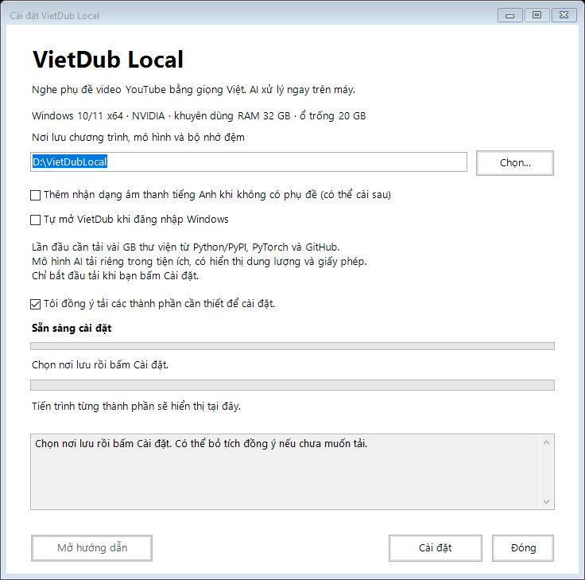

# Hướng dẫn cài và sử dụng VietDub Local

VietDub dịch phụ đề YouTube sang tiếng Việt và đọc bằng giọng Việt. Bản này dành cho Windows 10/11 64-bit, máy có NVIDIA; khuyên dùng RAM 32 GB và ổ đĩa còn trống ít nhất 20 GB. Lần đầu cần mạng để tải các thành phần và mô hình AI.

## Cài lần đầu

### 1. Tải bộ cài

1. Mở [trang tải VietDub Local](https://github.com/hacong86/VietDubLoca/releases/tag/v0.1.5-preview).
2. Cuộn xuống mục **Assets**. Bấm **VietDubLocal-0.1.5-win-x64.zip** để tải. Không chọn mục **Source code**.

### 2. Giải nén và cài

1. Trong thư mục **Tải xuống / Downloads**, nhấp chuột phải tệp vừa tải → **Giải nén tất cả / Extract All** → **Giải nén / Extract**.
2. Mở thư mục vừa giải nén, nhấp đúp **Setup.cmd**. Bộ cài chưa có chữ ký số; nếu Windows cảnh báo, hãy kiểm tra bạn đã tải đúng từ trang GitHub ở trên trước khi quyết định chạy.
3. Chọn nơi lưu còn đủ dung lượng, ví dụ `D:\VietDubLocal_Test`. Hãy nhớ nơi này để chọn tiện ích ở bước sau.
4. Ô đồng ý tải đã được đánh dấu sẵn. Bấm **Cài đặt**. Cửa sổ cho biết bước và thành phần đang tải; thanh chạy khi chưa biết dung lượng chỉ có nghĩa là đang xử lý. Chờ đến khi báo **Cài đặt hoàn tất**, rồi bấm **Mở hướng dẫn**.

Lần đầu có thể mất nhiều thời gian vì phải tải vài GB. Nếu mất mạng hoặc báo lỗi, mở lại **Setup.cmd**, chọn cùng nơi lưu rồi thử lại.

### 3. Thêm vào Chrome

1. Mở Chrome, gõ `chrome://extensions` vào thanh địa chỉ và nhấn Enter.
2. Bật **Chế độ dành cho nhà phát triển / Developer mode** ở góc trên.
3. Bấm **Tải tiện ích đã giải nén / Load unpacked**.
4. Mở nơi lưu đã chọn khi cài, chọn thư mục **extension** bên trong rồi bấm **Chọn thư mục**. Ví dụ: `D:\VietDubLocal_Test\extension`.
5. Bấm biểu tượng mảnh ghép của Chrome, tìm **VietDub Local** và mở tiện ích.

### 4. Chuẩn bị và xem

1. Bấm **Kết nối**. Nếu không kết nối được, mở **VietDub Local** trong Start của Windows rồi thử lại.
2. Vào tab **Mô hình**, xem dung lượng và giấy phép, đánh dấu đồng ý rồi bấm **Chuẩn bị để sử dụng**. Chờ đến khi thấy **Sẵn sàng dịch và đọc**.
3. Mở video YouTube có phụ đề, chẳng hạn phụ đề tiếng Thái hoặc tiếng Anh. Trong tab **Xem**, bấm **Bật tiếng Việt** và chờ chuẩn bị giọng đọc. Ứng dụng chọn một phụ đề có sẵn; tên ngôn ngữ được hiển thị ở mục nguồn.

## Cập nhật những lần sau

Nếu đang dùng 0.1.3 và gặp bản dịch vẫn là tiếng Thái, hãy cập nhật theo các bước sau rồi tắt/bật lại thuyết minh trên video để dịch lại. Model đã tải được giữ nguyên.

1. Mở thư mục nơi bạn đã cài VietDub, nhấp đúp **Cap-nhat-VietDub.cmd**.
2. Nếu có bản mới, chọn **Yes / Có**, chờ tải và cửa sổ cài đặt xuất hiện. Thư mục cài cũ đã được điền sẵn; bấm **Cài đặt** và chờ hoàn tất.
3. Trên Chrome mở `chrome://extensions`, tìm VietDub Local và bấm **Tải lại**.

Tệp cập nhật tự tải và giải nén bộ cài. Mô hình đã tải được giữ lại; nếu bản mới cần thành phần khác, chương trình có thể tải thêm. Khi đang xem video, hãy dừng thuyết minh trước khi cập nhật.

## Khi gặp lỗi

- **Không tìm thấy tệp cập nhật:** tải và giải nén gói Windows ở phần cài lần đầu, mở Setup.cmd và chọn đúng thư mục đã cài. Model ở thư mục đó được giữ lại.
- **Không cài được hoặc mất mạng:** thử lại với cùng thư mục. Khi cần hỗ trợ, ghi lại thông báo lỗi và xem `logs\install.log` trong nơi cài.
- **Có thể xóa thư mục cài cũ không?** Chỉ xóa sau khi đã sao lưu và xác nhận không còn cần dữ liệu: trong đó có thể có model, cấu hình, lịch sử, bản sửa và khóa riêng. Xóa model sẽ phải tải lại; không gửi khóa riêng cho người khác.

Bản thử nghiệm chưa được kiểm trên mọi cấu hình máy. Chất lượng và khả năng chọn đúng ngôn ngữ có thể khác nhau theo video. Nhận dạng âm thanh khi video không có phụ đề hiện chỉ hỗ trợ tiếng Anh.
